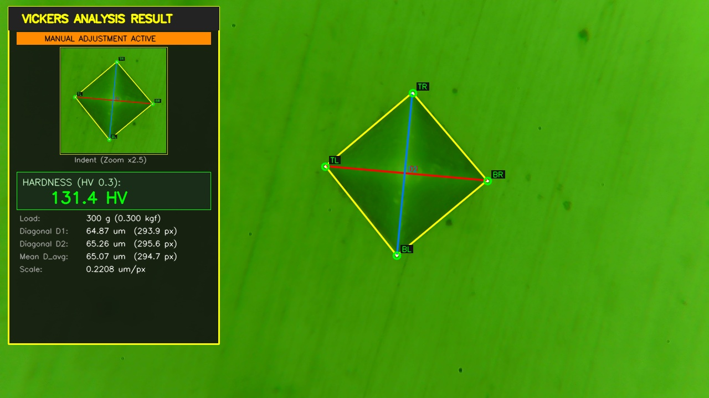
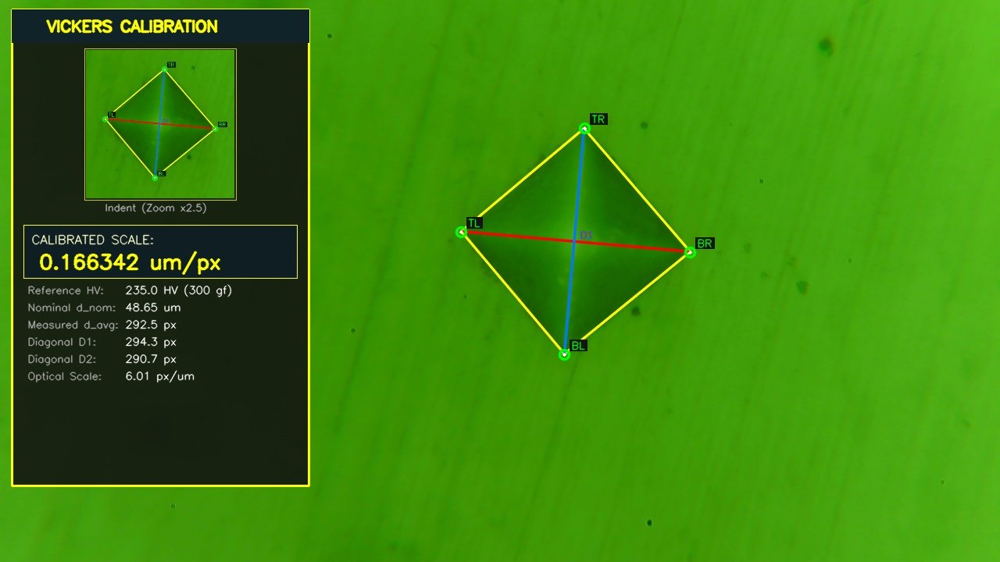

# Vickers Microhardness Analyzer (OpenCV & Python)

[English](#english) | [Русский](#русский)

---

<a name="english"></a>
## English

An automated computer vision system for Vickers microhardness indentation measurement and analysis through a microscope USB camera feed. 

Compliant with **ISO 6507** and **ASTM E384** standards.



### Key Features

- **Live Camera Feed**: Real-time video streaming with DirectShow support on Windows (1280x720).
- **Multi-Camera Switching**: Instant camera cycling with `[V]` / `[TAB]`, automatically saved to `calibration.json`.
- **Robust Indent Detection**:
  - Handles arbitrary rotation angles (square at 0°, diamond at 45°, or tilted).
  - Resilient to defocus, light reflection, surface polishing scratches, and dust.
  - Sub-pixel edge localization using normal gradient vector projections.
- **Interactive Drag-and-Drop Adjustment**:
  - Mouse corner point repositioning (`TL`, `TR`, `BR`, `BL`).
  - Dual adjustment: drag points on the full image or inside the magnified **2.5x Zoom Inset**.
  - Instant live recalculation of diagonals ($D_1$, $D_2$, $D_{\text{avg}}$) and Vickers hardness ($HV$).
  - One-key reset (`[R]`) to return to initial automatic detection.
- **Reference Hardness Calibration**:
  - Direct input of certified reference hardness (HV) from standard calibration blocks.
  - Automatic conversion from target HV to theoretical diagonal ($d_{\text{nominal}}$) and optical scale ($\mu\text{m/px}$).
- **Non-destructive Saving**:
  - Clean unannotated frames are saved upon capture.
  - Annotated measurement reports are saved **only when the review window is closed**.



### Mathematical Formulation

Vickers hardness number ($HV$) is calculated according to ISO 6507:
$$HV = \frac{2 \cdot F \cdot \sin(136^\circ / 2)}{d^2} \approx \frac{1.85437 \cdot F_{\text{kgf}}}{d_{\text{mm}}^2}$$

Where:
- $F_{\text{kgf}}$ = test load in kilogram-force (e.g. $300\text{ gf} = 0.300\text{ kgf}$)
- $d_{\text{mm}}$ = mean length of diagonals in millimeters: $d_{\text{mm}} = \frac{D_1 + D_2}{2 \times 1000}$

Theoretical diagonal from certified reference hardness:
$$d_{\text{nominal, }\mu\text{m}} = \sqrt{\frac{1.85437 \cdot F_{\text{kgf}}}{HV_{\text{target}}}} \times 1000$$

### Installation

1. Clone repository:
   ```bash
   git clone https://github.com/<your-username>/<repo-name>.git
   cd <repo-name>
   ```

2. Install dependencies:
   ```bash
   pip install -r requirements.txt
   ```

### Quickstart

Run camera feed and measurement tool:
```bash
python capture.py
```

### Hotkey Reference

| Hotkey | Description |
| :--- | :--- |
| **`[SPACE]`** / **`[S]`** | Capture current frame & open interactive measurement window |
| **`[V]`** / **`[TAB]`** | Switch between connected USB cameras (saved automatically) |
| **`[M]`** | Toggle live indent analysis overlay on/off |
| **`[C]`** | Open calibration mode (input certified test block HV) |
| **`[Q]`** / **`[ESC]`** | Exit program |

#### In the Measurement Window:
- **Left Mouse Button Drag**: Grab any corner vertex (`TL`, `TR`, `BR`, `BL`) in full view or inside the Zoom Inset to adjust.
- **`[R]`**: Reset vertices back to initial auto-detection.
- **`[SPACE]` / `[ENTER]` / `[ESC]` / Close 'X'**: Confirm and save final report image.

#### In the Calibration Window:
- **`[T]`**: Edit target reference hardness ($HV$) on the fly.
- **`[SPACE]` / `[ENTER]`**: Save new scale to `calibration.json` and apply.
- **`[ESC]`**: Cancel without modifying calibration.

---

<a name="русский"></a>
## Русский

Программный комплекс компьютерного зрения для автоматического определения границ отпечатка индентера, расчёта диагоналей и микротвёрдости по шкале Виккерса (HV) через USB-камеру микроскопа.

Соответствует стандартам **ГОСТ 9450-76**, **ISO 6507** и **ASTM E384**.

### Основные возможности

- **Трансляция с камеры в реальном времени**: подключение через DirectShow под Windows (1280x720).
- **Переключение между камерами**: горячая клавиша `[V]` / `[TAB]` переключает видеопоток между несколькими камерами, сохраняя выбор в `calibration.json`.
- **Надёжное распознавание отпечатка**:
  - Работает при любом угле поворота (квадрат 0°, ромб 45° или произвольный наклон).
  - Устойчиво к расфокусировке, бликам полировки, царапинам и загрязнениям.
  - Субпиксельное уточнение граней по проекциям градиента нормалей.
- **Интерактивная ручная подстройка (Drag & Drop)**:
  - Перетаскивание любой вершины (`TL`, `TR`, `BR`, `BL`) левой кнопкой мыши.
  - Подстройка как на общем плане, так и в окне **Zoom Inset x2.5**.
  - Мгновенный пересчёт диагоналей ($D_1$, $D_2$, $D_{\text{avg}}$) и твёрдости по Виккерсу в процессе перетаскивания.
  - Клавиша `[R]` для быстрого сброса к исходному автоопределению.
- **Калибровка по эталонной мере твёрдости**:
  - Прямой ввод паспортной микротвёрдости меры (HV).
  - Автоматический расчёт теоретической диагонали и масштаба оптической системы ($\mu\text{m/px}$).
- **Безопасное сохранение**:
  - Исходный чистый кадр сохраняется сразу при захвате.
  - Кадр с результатами измерений сохраняется **только в момент закрытия окна просмотра**.

### Установка

1. Клонируйте репозиторий:
   ```bash
   git clone https://github.com/<your-username>/<repo-name>.git
   cd <repo-name>
   ```

2. Установите зависимости:
   ```bash
   pip install -r requirements.txt
   ```

### Запуск

```bash
python capture.py
```

### Таблица горячих клавиш

| Клавиша | Действие |
| :--- | :--- |
| **`[ПРОБЕЛ]`** / **`[S]`** | Захват кадра и открытие окна интерактивного измерения |
| **`[V]`** / **`[TAB]`** | Переключение между подключёнными камерами (с автосохранением) |
| **`[M]`** | Включение/выключение режима живого анализа в видеопотоке |
| **`[C]`** | Режим калибровки по паспортной твёрдости эталонного образца (HV) |
| **`[Q]`** / **`[ESC]`** | Выход из программы |

#### В окне измерений:
- **ЛКМ (зажать и тянуть)**: перемещение вершин (`TL`, `TR`, `BR`, `BL`) в кадре или окне зума.
- **`[R]`**: сброс точек к первоначальному положению автоопределения.
- **`[ПРОБЕЛ]` / `[ENTER]` / `[ESC]` / Крестик окна**: подтверждение и сохранение итогового файла.

#### В окне калибровки:
- **`[T]`**: быстрое изменение целевой твёрдости меры (HV).
- **`[ПРОБЕЛ]` / `[ENTER]`**: сохранение масштаба в `calibration.json` и применение.
- **`[ESC]`**: отмена калибровки без сохранения.

---

### Лицензия

MIT License.
